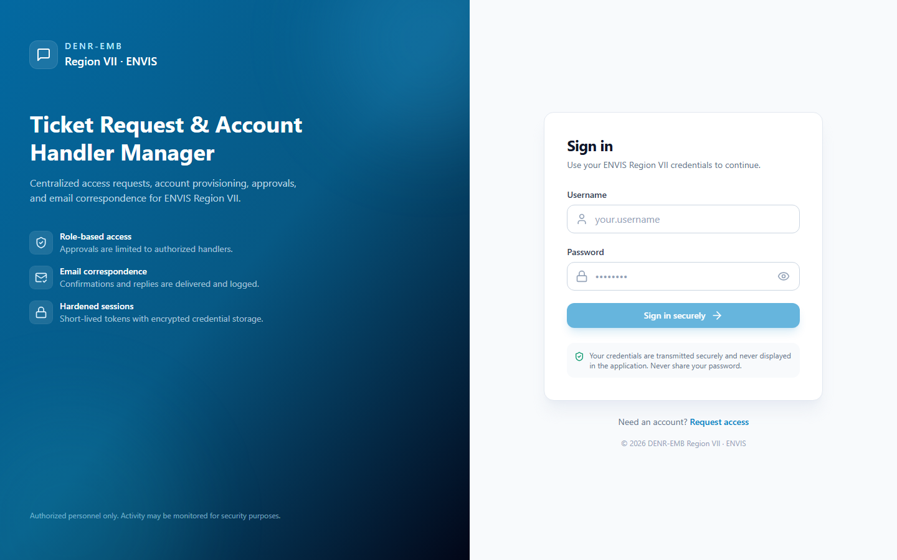
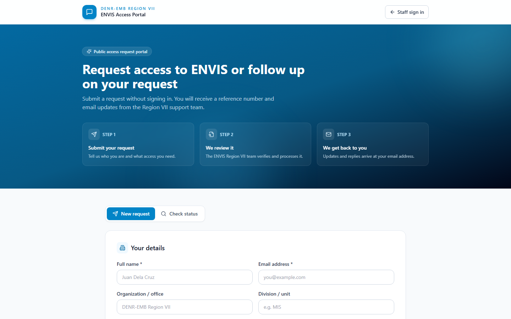
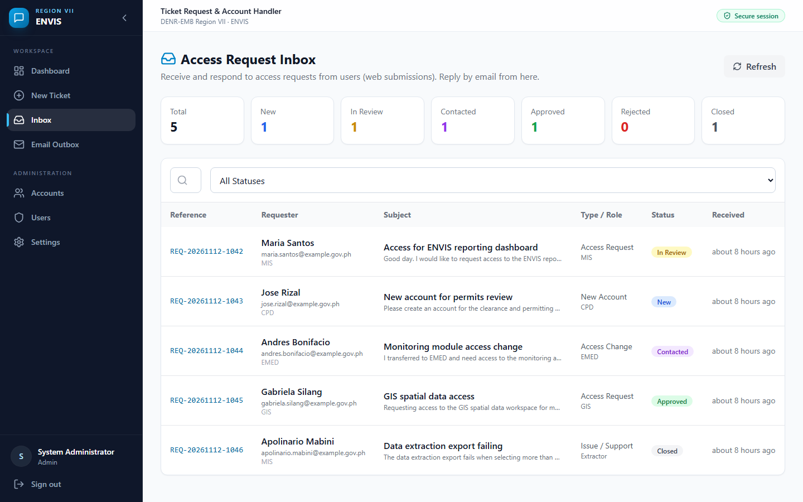
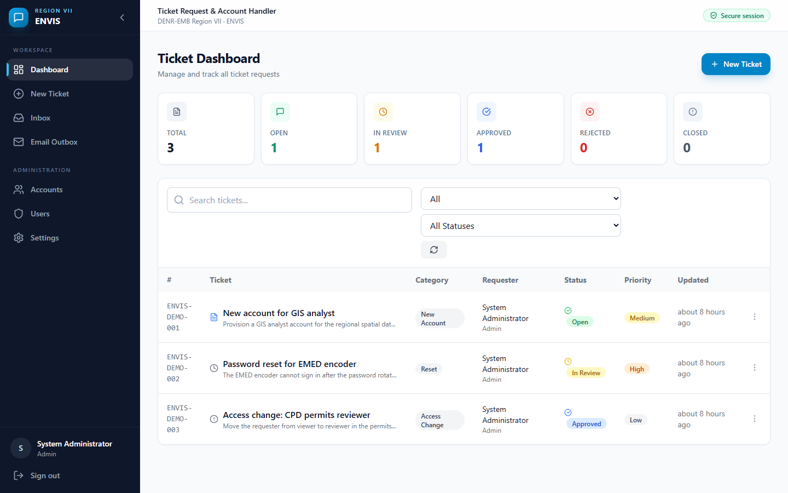
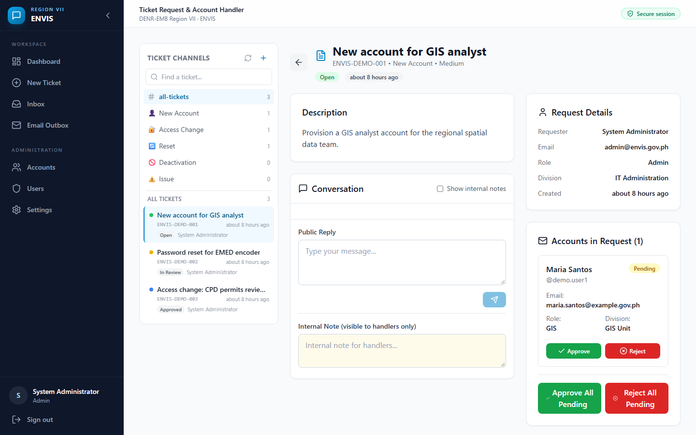
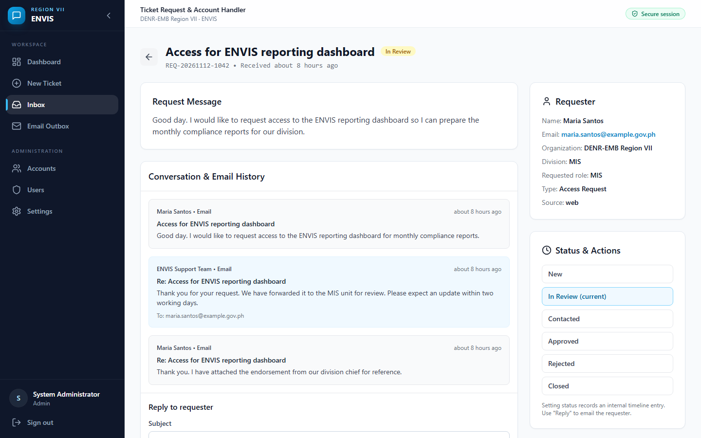

# ENVIS Ticket Request & Account Handler Manager

A Discord-style ticket and account-handling system for DENR-EMB Region VII
(ENVIS). Staff raise requests, handlers review them, and every decision is
confirmed by email — all in one auditable workspace.



## Overview

The system replaces ad-hoc account requests (chat messages, paper forms, shared
spreadsheets) with a single workflow:

- A public portal lets anyone request access without an account.
- Staff handle requests in a shared inbox and reply by email.
- Internal tickets can carry **multiple accounts** that are approved or rejected
  individually.
- Approved accounts are provisioned automatically and credentials are delivered
  to the requester by email.
- Every ticket, account decision, message, and outgoing email is recorded.

## Screenshots

| Public access portal | Staff inbox |
|---|---|
|  |  |

| Ticket dashboard | Ticket conversation |
|---|---|
|  |  |

### Request detail and reply



## Workflow

### 1. Public access request

A requester opens the public portal, submits their details, and receives a
reference number. The intake is rate-limited and validated, and a confirmation
email is sent to the requester while handlers are notified of the new request.

### 2. Staff inbox triage

Handlers see new requests in the shared inbox, open the request, and can:

- change its status (New → In Review → Contacted → Approved / Rejected / Closed)
- assign it to a handler
- reply to the requester directly by email
- read the full email thread for that request

### 3. Internal tickets

Staff create tickets for account work. A single ticket can contain **multiple
account rows**, each with its own role, division, and status. The conversation
view keeps the request, the account list, and handler actions side by side.

### 4. Account decisions

Handlers approve or reject accounts individually or in bulk. Approving an
account provisions the ENVIS account, assigns the requested role and division,
and emails the credentials to the requester. Rejections notify the requester
with the recorded reason.

### 5. Email correspondence

Every notification, reply, and credential delivery is queued through the email
service and logged in the **Email Outbox**. Failed deliveries can be retried
without recreating the message, so correspondence is never silently lost.

### 6. Users and roles

Administrators can enable or disable users, reset passwords, and change roles.
Role permissions decide who can view all tickets, approve or reject accounts,
manage users, and manage accounts.

| Permission | Admin | Regional Director | EMED | CPD | MIS | Extractor | GIS |
|---|---|---|---|---|---|---|---|
| View all tickets | ✓ | ✓ | ✓ | ✓ | ✓ | | |
| Approve accounts | ✓ | ✓ | ✓ | ✓ | ✓ | | |
| Reject accounts | ✓ | ✓ | ✓ | ✓ | ✓ | | |
| Manage users | ✓ | ✓ | | | | | |
| Manage accounts | ✓ | | | | ✓ | | |
| Create tickets | ✓ | ✓ | ✓ | ✓ | ✓ | ✓ | ✓ |
| View own tickets | ✓ | ✓ | ✓ | ✓ | ✓ | ✓ | ✓ |

## Architecture

| Layer | Technology |
|---|---|
| Frontend | Vite + React + TypeScript + Tailwind CSS |
| Backend | Node.js + Express + TypeScript |
| Database | SQLite (better-sqlite3, WAL mode) |
| Email | Nodemailer over SMTP |
| Auth | Short-lived JWT access tokens |

```
├── shared/     Shared types, roles, permissions, validation helpers
├── backend/    Express API, database schema and seed, email service
│   ├── routes/     Auth, tickets, accounts, requests, users, emails
│   ├── services/   SMTP transport and email templates
│   ├── middleware/ Authentication, authorisation, security headers
│   └── utils/      Database, JWT, validation, encrypted secret store
└── frontend/   React single-page application
    ├── pages/      Login, public portal, dashboard, ticket, inbox, settings
    └── components/ App shell, conversation view, account panels
```

## Getting Started

### Prerequisites

- Node.js 22+ (required by better-sqlite3)
- npm 10+

### Install

```bash
npm install
npm run build --workspace=shared
```

### Run

```bash
npm run dev
```

The first backend start creates the database, applies the schema, and seeds the
base roles. The database and its credentials file are created outside version
control and are never committed.

### Build for production

```bash
npm run build
npm run start --workspace=backend
```

In production mode the backend serves the built frontend from the same origin
and applies a Content Security Policy appropriate for both the API and the
application.

## Accounts and Secrets

This repository contains **no credentials**.

- Account passwords are supplied at provisioning time (or generated randomly),
  stored as bcrypt hashes, and never returned by the API.
- JWT signing keys, SMTP credentials, and notification addresses live in an
  AES-256-GCM encrypted store outside the repository, unlocked by a local key
  file owned by the operating-system account running the service.
- Real environment variables always take precedence, so a deployment can inject
  secrets through its platform instead of using the local store.
- Run the interactive secret setup to create or rotate the local store:

```bash
npm run secrets:setup --workspace=backend
```

- `.env` holds only non-sensitive runtime configuration (mode, database path,
  SMTP host and port). It is git-ignored, and the file permissions are
  restricted to the service account.
- Existing accounts are never re-hashed on startup, so password changes made in
  the application are preserved.

Never commit `.env`, the database, generated credentials, or email exports.
Rotate secrets immediately if any of them is ever exposed.

## Security Notes

- Role-based authorisation on every route, with ownership checks for tickets.
- Internal notes are hidden from users who cannot approve accounts.
- Parameterised SQL everywhere; no user value is concatenated into a query.
- Identical error messages and a dummy hash comparison on failed sign-in.
- Per-IP rate limits on the API, sign-in, and public intake.
- Strict CORS allowlist, hardened security headers, and no framework fingerprint.
- Secrets are redacted from logs and API error responses.
- Passwords hashed with bcrypt; account passwords are never displayed in the UI.

For an internet-facing deployment, terminate TLS at a reverse proxy, enable
`TRUST_PROXY` so client IPs are resolved correctly, use httpOnly cookie sessions,
and add multi-factor authentication for privileged roles.

## License

Internal use only — DENR-EMB Region VII.
